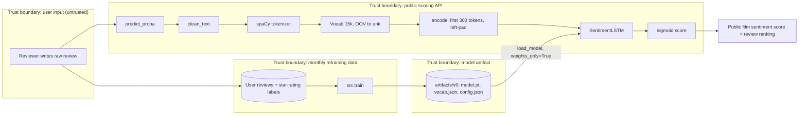

# Threat Model — IMDb LSTM Sentiment Classifier

Status: **Phase 1, hypotheses only.** Nothing in this document is a measured result. Every
threat below is a hypothesis to be tested in a later phase against the frozen attack set
(`redteam/attack_set.json`) and the `v0-baseline` model.

## 1. System description

The model scores a review with a single number: the probability that it is positive. Every
review passes through the same pipeline, implemented in `src/` and exposed through
`src/predict.py: predict_proba`:

| Step | Code | Behaviour |
|---|---|---|
| Clean | `src/preprocess.py: clean_text` | Strip HTML (BeautifulSoup), remove URLs, expand contractions, lowercase, remove digits, replace every character outside `[a-z\s]` with a space, collapse whitespace |
| Tokenize | `src/data.py: tokenizer` | spaCy `en_core_web_sm` rule-based tokenizer |
| Numericalize | `src/data.py: Vocab` | 15,000 entries (`<pad>`=0, `<unk>`=1, top 14,998 training tokens); unknown tokens map to `<unk>` |
| Truncate / pad | `src/data.py: encode` | Keep the **first** 300 tokens; left-pad shorter sequences with `<pad>` |
| Classify | `src/model.py: SentimentLSTM` | Embedding(128) → single-layer LSTM(128) over the non-pad tokens → linear → logit |
| Score | `src/predict.py: predict_proba` | Sigmoid of the logit; ≥ 0.5 means positive |

## 2. Scenario: ReelRate (fictional)

ReelRate is a fictional film-review platform. Each submitted review is scored by the model.

- The **public film sentiment number** is computed from the scores of that film's reviews.
- **Review ranking** uses the scores to decide which reviews appear first.
- The platform exposes a **public scoring API**. Anyone can submit text and receive the score.
- The model is **retrained monthly** on newly submitted reviews. Each review's label comes from its
  star rating (high stars = positive, low stars = negative).
- Model artifacts are stored as files and loaded by the scoring service at start-up.

## 3. Assets

| ID | Asset | Why it matters |
|---|---|---|
| AS1 | Score integrity | A review's score should reflect its actual sentiment |
| AS2 | Film sentiment number and ranking integrity | Public, decision-relevant output derived from AS1 |
| AS3 | Training-data integrity | Monthly retraining inherits whatever is in the data |
| AS4 | Model artifact integrity | The loaded checkpoint decides every score |
| AS5 | Scoring-service availability | Out of scope for attacks here; listed for completeness |

## 4. Adversaries

### A1 — Astroturfer
- **Goal:** move a film's public sentiment number or ranking. Make negative text score positive, or
  the reverse, while the text still reads as its true sentiment to humans.
- **Access:** writes reviews and queries the public scoring API.
- **Knowledge levels considered:**
  - *Black-box, score-based:* sees the probability returned by the API.
  - *Black-box, label-only:* sees only positive or negative.
  - *White-box:* has the weights and vocab. This is an upper bound, for example after an artifact
    leak.
- **Constraints:** limited by query budget and by the need to keep the text plausible to human
  readers and moderators.

### A2 — Data poisoner
- **Goal:** change the behaviour of the next monthly model. For example, make a chosen phrase force
  a chosen label (backdoor), without lowering clean accuracy enough to be noticed.
- **Access:** submits reviews with star ratings that enter the retraining set. A2 does not control
  the training code, the split or the hyperparameters.
- **Knowledge:** knows the pipeline design (public documentation level). May or may not know the
  weights.
- **Constraints:** controls a small fraction of the training data. The poisoned reviews must pass
  normal moderation.

## 5. Threat table

OWASP IDs follow the OWASP Machine Learning Security Top 10. The MITRE ATLAS column gives technique
**names** only. ATLAS IDs have been renumbered between releases, so map them against the ATLAS
version in use before citing IDs.

| ID | Threat | Hypothesis | Code location that causes it | OWASP ML Top 10 | MITRE ATLAS technique | Planned test |
|---|---|---|---|---|---|---|
| M1 | Truncation blind spot | Tokens after position 300 never reach the model. Sentiment-bearing text placed there should therefore have no effect on the score, and the score is decided by the first 300 tokens only. | `src/data.py: encode` (keeps `indices[:MAX_LEN]`) | ML01 Input Manipulation Attack | Craft Adversarial Data; Evade ML Model | On attack-set reviews, compare scores with text added before vs after token 300. Report the share of the 103 attack-set reviews longer than 300 tokens whose score depends only on the prefix. |
| M2 | Obfuscation destroyed by `clean_text` | Replacing every non `[a-z\s]` character with a space splits or erases obfuscated words. Character-level obfuscation should therefore push sentiment words to `<unk>` or meaningless fragments. A human reader still sees the intended word. | `src/preprocess.py: clean_text` (`re.sub(r"[^a-z\s]", " ", ...)`) | ML01 Input Manipulation Attack | Craft Adversarial Data; Evade ML Model | Measure the score shift and the `<unk>` rate when sentiment words in attack-set reviews are perturbed at character level. Record how many perturbed words survive cleaning. |
| M3 | Black-box greedy synonym substitution | A score-based black-box attacker can flip labels by replacing a small share of words with near-synonyms, with a modest query budget (TextFooler-style family). | `src/predict.py: predict_proba` (returns a continuous score to the caller) | ML01 Input Manipulation Attack | Craft Adversarial Data; Evade ML Model | Run a greedy substitution attack on the attack set within a fixed query budget. Report ASR per direction, % words changed and queries per success. Repeat label-only if feasible. |
| M4 | White-box gradient-guided substitution + embedding-PGD upper bound | With weights available, gradient-guided token substitution (HotFlip-style family) needs fewer changes than M3. Continuous PGD in embedding space bounds what any token-level attack can achieve. | `src/model.py: SentimentLSTM` (differentiable embedding → LSTM) | ML01 Input Manipulation Attack | Craft Adversarial Data (white-box) | Run token substitution guided by embedding gradients and compare with M3 at equal edit budgets. Run embedding-space PGD as a non-realizable upper bound and label it as such. |
| M5 | Trigger-phrase backdoor via poisoned retraining data | A small fraction of training reviews that contain a fixed phrase, all with the same star-rating label, implants a backdoor. The phrase then forces that label while clean accuracy stays near baseline (BadNets-style family). | `src/train.py` (trains on all supplied labelled data without provenance or anomaly checks); `src/data.py: load_dataframe` | ML02 Data Poisoning Attack | Poison Training Data; Backdoor ML Model | Retrain copies of the model with poison rates in a small range, using a separate artifact tag, never `v0`. Report trigger ASR on the attack set and clean test accuracy for each rate. |
| M6 | Unsafe checkpoint deserialisation | Loading a checkpoint with full pickle deserialisation would run attacker-supplied code from a tampered `model.pt`. **Existing control:** `torch.load(..., weights_only=True)` in `src/predict.py: load_model` allows tensors only. | `src/predict.py: load_model` | ML06 AI Supply Chain Attacks | Publish Poisoned Models / supply-chain compromise of model artifacts | Build a harmless test artifact containing a non-tensor object and confirm that `load_model` rejects it. Add artifact hash verification as a candidate defence. |

### Out of scope

| Item | OWASP ML Top 10 | Reason |
|---|---|---|
| Model extraction / stealing | ML05 Model Theft | A1's goal is to manipulate scores, not to copy the model. White-box knowledge is covered as an assumption in M4. |
| Membership inference | ML04 Membership Inference Attack | The training data is public IMDb reviews, so membership reveals nothing sensitive in this scenario. |

## 6. Metrics and protocol

- **Attack set:** `redteam/attack_set.json`, built by `python -m redteam.make_attack_set`.
  - 500 test-split reviews that v0 classifies correctly: 250 negative and 250 positive.
  - Sampled with seed 42 from the frozen split in `artifacts/v0/splits.json`.
  - Every attack phase uses this file unchanged.
- **Attack success rate (ASR):** the share of attacked reviews whose predicted label flips.
  Reported separately per direction, pos→neg and neg→pos.
- **Perturbation size:** % of words changed per successful example (mean and median).
- **Cost:** model queries per success, for black-box attacks.
- **Semantic check:** for each attack, manually read 20 sampled successful examples. Record whether
  the true sentiment is preserved for a human reader. Results with a low preservation rate are
  reported as such and are not counted as clean successes.
- **Defences:** report clean test accuracy next to every defence's robustness number.
- **Run logging:** every run records the model tag, git commit, seed, attack parameters and date
  in `redteam/LOG.md` and in the run's output file.

## 7. Baseline note

- **v0-baseline:** 85.95% test accuracy (`artifacts/v0/metrics.json`), ROC-AUC 0.9322.
- **Provenance:** the artifacts were trained from the `src/` code at commit `d38fff9`.
  `artifacts/v0/config.json` records `git_commit: 2815539` with `git_dirty: true`, because training
  ran before the `src/` package was committed.
- **Model maths since then:** the forward pass was later vectorised. It was verified equivalent on
  the v0 checkpoint (`tests/test_model_equivalence.py`, max |Δlogit| < 1e-5).
